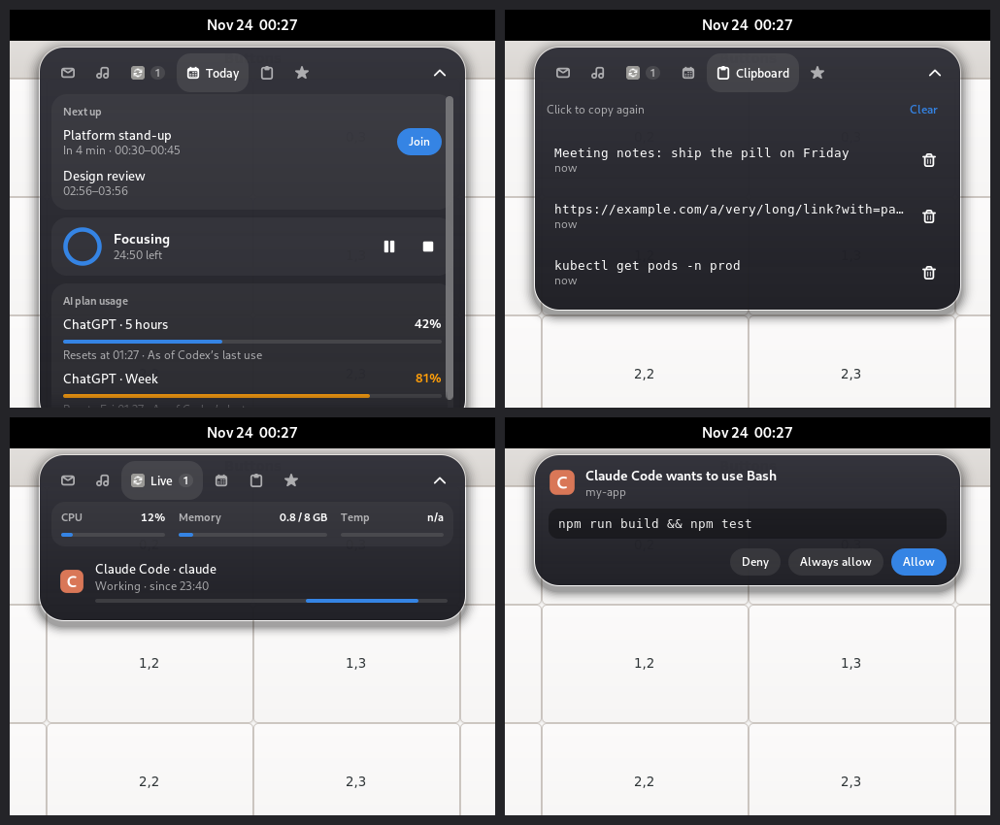

# Top Pill

A Dynamic Island–style pill for GNOME Shell: one small pill at the top centre of the screen for what's happening right now — music, notifications, downloads and updates, AI agents, meetings, a focus timer — that tucks into the top bar when a window is underneath.



Requires **GNOME Shell 50** (Wayland). Tested on Ubuntu 26.04.

## Install
```
git clone https://github.com/Jude/top-pill.git
cd top-pill
bash install.sh
```
The first time, log out and back in once. After that, running `install.sh` again
reloads Top Pill in place, so updates appear within a second without logging out.
To remove it: `./uninstall.sh` (add `--purge` to also reset its settings).

## Checking on it
`install.sh` also installs a `top-pill` command:
| Command | What it does |
|---|---|
| `top-pill status` | What each part is doing, and the last errors |
| `top-pill doctor` | Status, plus checks that the installed files are intact and how agent hooks and audio are set up |
| `top-pill reload` | Restart Top Pill in place |
| `top-pill rollback` | Go back to the previous install (the last three are kept) |
| `top-pill logs` | Top Pill's lines from this login's system log |

If an update ever fails to start, Top Pill falls back to the previous install on its own and `top-pill doctor` says so.
If one part fails (say, the calendar), the rest keeps working and `top-pill status` shows which part and why.

## Using it
- **Click** the pill to open it. Click anywhere else, or press Esc, to close it.
- **Scroll** on the pill, or click the dots, to switch between activities. The bubble beside it shows the next one.
- **Right-click** for settings. **Super+Shift+N** opens and closes it.
- New notifications wait a moment, then **peek** with a sound and a one-line preview. Click the peek to open that message.
- When a window is under the pill, or in the overview, it **tucks into the top bar** next to the clock. Bring the pointer near and it slides back out.

## What it shows
| Tab | Contents |
|---|---|
| Inbox | GNOME's notifications with real app icons, category filters, Clear all, and a buddy to play with when it's empty |
| Media | Any MPRIS player (Spotify, browsers, VLC…) with artwork, an artwork-coloured tint, a wavy progress line you can click to seek, and controls |
| Media | …plus synced lyrics (current and next line) when the song has them |
| Live | CPU, memory and temperature, then Software Updater (aptdaemon), App Center and snap refreshes (snapd), PackageKit, browser downloads, Claude Code, Codex CLI, Gemini CLI, Copilot CLI, Ollama and LM Studio, plus microphone, camera and screen-sharing indicators |
| Today | Your next calendar events with a **Join** button for Meet, Zoom, Teams and Webex links; a focus timer (25/5 by default); Claude and ChatGPT plan usage with reset times |
| Clipboard | The last 30 things you copied (text). Click one to copy it again |
| Trending | Tech, DevOps, AI and New tools headlines from free public feeds |

It also peeks when Bluetooth headphones connect (with battery level), a few minutes before a meeting, and when a focus round ends.

## Answer Claude Code and Codex from the pill
When Claude Code or Codex needs permission to run something, the pill drops down with the command and **Deny / Always allow / Allow**. It also tells you when an agent finishes or is waiting for you.
To turn this on, run once:
```
top-pill hooks enable
```
This adds a small hook to `~/.claude/settings.json` and `~/.codex/hooks.json` (your own hooks are kept, and the original files are backed up once as `*.before-top-pill`). `top-pill hooks disable` removes it; `top-pill hooks status` shows what's set.
If the pill isn't running or you answer in the terminal first, the agent simply asks in its terminal as usual. Very long commands always go to the terminal.

## Works with GNOME settings
- **Do Not Disturb** and per-app notification settings still apply, because notifications stay in GNOME. Urgent alerts still use GNOME's own banner.
- **Look:** follows your accent colour, light/dark style (Style: Auto), text size and high contrast.
- **Animations:** follows the Animations setting in Accessibility.
- **Visibility:** hidden for fullscreen apps, steps aside while a top-bar menu is open, and isn't shown on the lock screen.

## What it reads, and how often
- **AI agents:** every 4 s it lists running processes to spot AI agents. It only reads process names, CPU time and working folder.
- **Local models:** while Ollama or LM Studio is running, it asks their local APIs which models are loaded.
- **Snaps:** about every 8 s it asks snapd for in-progress changes. It checks faster only while something is happening.
- **Music bars:** they read the *output* level (what you hear) while music plays and the bars are visible. They don't use the microphone and don't trigger the microphone indicator.
- **Trending:** fetched every 30 minutes (adjustable), never on metered connections. The Trending page in settings shows whether each source is working.
- **Claude plan usage:** only while the Today tab is open (at most every 10 minutes), it reads Claude Code's own sign-in (`~/.claude/.credentials.json`) and asks Anthropic's usage endpoint. That sign-in is only ever sent to api.anthropic.com.
- **ChatGPT plan usage:** read from Codex's local session logs when the Today tab opens. Nothing is sent.
- **Lyrics:** the artist and song title are sent to LRCLIB (a free lyrics service) once per song; results are cached in `~/.cache/top-pill/lyrics`.
- **Calendar:** read from GNOME's calendar service (the accounts you added in Online Accounts). Nothing is sent.
- **Clipboard:** text only, kept in memory (it survives locking the screen) and gone when you log out. Copies marked as passwords by password managers are skipped. Turn it off in settings → Today.
- **Focus timer:** its state is saved in `~/.cache/top-pill/focus.json`, so it keeps time through screen locks, sleep and updates.
- **System stats:** read from `/proc` and the temperature sensors, only while the Live tab is open.
- No new accounts or API keys. Each of these can be switched off in settings.

## Credits
Feature ideas came from open-source projects doing similar things: Isle, NexNotch, Dynamic Island and NotchNux. Top Pill's code is its own.

## Light on resources
Nothing animates while the pill is hidden (fullscreen, a top-bar menu open). When idle it does no per-frame work: the face blinks every few seconds, the agent orb breathes briefly and rests, and the music bars move on the graphics card instead of being redrawn. Plan usage is only read while you're looking at it, and the calendar and Live list only update the pill when something actually changed.

## Troubleshooting
Start with `top-pill doctor`. For the full log: `top-pill logs`.
If the pointer ever stops responding, Super+L and unlocking frees it; then run `top-pill doctor` and send the output.

## License
GPL-3.0-or-later. See [LICENSE](LICENSE).
